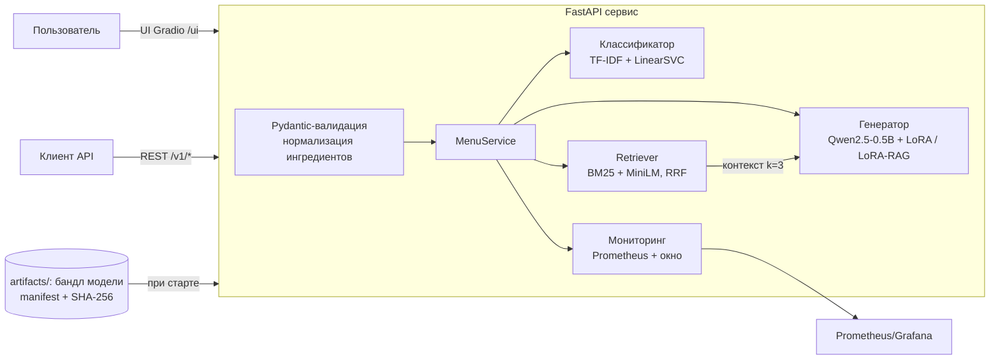

# 🍽️ Меню от нейросетей — Menu from Neural Networks

[](https://github.com/K4n4y3/FinalProject/actions/workflows/ci.yml)
[](https://github.com/K4n4y3/FinalProject/actions/workflows/deploy.yml)
 

Интеллектуальная система, которая по списку ингредиентов:

1. **определяет тип блюда** — TF-IDF + LinearSVC, 9 классов, test macro-F1 **0.719**;
2. **придумывает название** — Qwen2.5-0.5B-Instruct + LoRA, test ROUGE-L **0.387** (RAG-варианты сравнены, см. Model card);
3. **отвечает «что приготовить из…»** — чат-ассистент, опирающийся на 14 543 рецепта Epicurious, с источниками.

Финальный проект курса *AI Essentials: Theory and Applications* (Biloshchytskyi Yevhenii, AAI-2602): продолжение
Assignments 1–4 — от постановки задачи и подготовки данных до обученной модели, развёрнутой как сервис.

| | |
|---|---|
| **Запуск** | `start_local.bat` (Docker Compose: сервис + Prometheus + Grafana), см. [DEPLOYMENT](docs/DEPLOYMENT.md) |
| **UI** | http://localhost:7860/ui |
| **REST API** | `/docs` (Swagger), `/redoc` |
| **Мониторинг** | `/metrics` (Prometheus), `/v1/monitoring`, вкладка «Мониторинг» в UI, Grafana через `docker compose` |
| **Модель** | версионированный бандл `artifacts/` (manifest + SHA-256), см. [MODEL_CARD](docs/MODEL_CARD.md) |

## Архитектура в двух словах



Подробно: [docs/ARCHITECTURE.md](docs/ARCHITECTURE.md).

## Быстрый старт

```bash
# 1. окружение (uv: https://docs.astral.sh/uv)
uv sync --extra llm                      # без --extra llm: классификатор + поиск, генерация в fallback-режиме

# 2. данные и модель
uv run menu build-data path/to/full_format_recipes.json      # очистка + разбиение (A2), ~20 с
uv run menu build-bundle --lora adapters/lora --lora-rag adapters/lora_rag --version 1.0.0
#    или скачать готовый бандл: MENU_HF_REPO=K4n4y3/menu-from-nn MENU_HF_REVISION=v1.0.0

# 3. сервис
uv run menu serve                         # http://localhost:7860/ui · /docs · /metrics
```

Docker (сервис + Prometheus + Grafana): `start_local.bat` на Windows или

```bash
docker compose up -d --build              # UI :7860/ui · Prometheus :9090 · Grafana :3000
docker compose --profile loadtest run --rm loadtest     # нагрузочный тест
```

Пример запроса:

```bash
curl -X POST localhost:7860/v1/menu -H 'content-type: application/json' \
     -d '{"ingredients": ["2 oz white rum", "1 lime", "mint leaves", "sugar", "club soda"]}'
```

## Репозиторий

```
src/menu/            пакет: data, text, metrics, models/, rag/, service, api/, ui/, monitoring, bundle, training, cli
tests/               pytest: unit, API-контракт, деградация, регрессия против чисел A4 (47 тестов)
notebooks/           final_training.(py|ipynb) — обучение LoRA и LoRA-RAG на Kaggle T4, выбор финальной модели
loadtest/            locust-профиль нагрузки + сводка
monitoring/          Prometheus (alert rules) и Grafana (готовый дашборд)
deploy/, scripts/    деплой на Hugging Face Spaces, сборка демо-бандла, py→ipynb
reports/a4/          результаты Assignment 4 (эталон для регрессионных тестов)
docs/                архитектура, модель, API, деплой, мониторинг, тестирование, производительность
```

## Разработка

```bash
uv run ruff check . && uv run ruff format --check .   # линтер и форматирование
uv run mypy                                            # типы
uv run pytest --cov                                    # тесты (без сети: синтетика + крошечная Qwen2)
uv run pre-commit install                              # хуки перед коммитом
```

CI (GitHub Actions) на каждый push: ruff → mypy → pytest с покрытием → сборка Docker-образа и smoke-тест
контейнера. Опционально после CI — деплой на Hugging Face Spaces (`deploy.yml`).

## Документация

| документ | о чём |
|---|---|
| [ARCHITECTURE](docs/ARCHITECTURE.md) | компоненты, потоки данных, решения и альтернативы |
| [MODEL_CARD](docs/MODEL_CARD.md) | финальная модель: выбор, версии, вход/выход, метрики, ограничения |
| [API](docs/API.md) | эндпоинты, схемы, коды ошибок, примеры |
| [DEPLOYMENT](docs/DEPLOYMENT.md) | обучение на Kaggle → бандл на HF Hub → Space; локально и в Docker |
| [MONITORING](docs/MONITORING.md) | метрики, дрейф, алерты, дашборд |
| [TESTING](docs/TESTING.md) | стратегия тестирования и как запускать |
| [PERFORMANCE](docs/PERFORMANCE.md) | задержки и пропускная способность |
