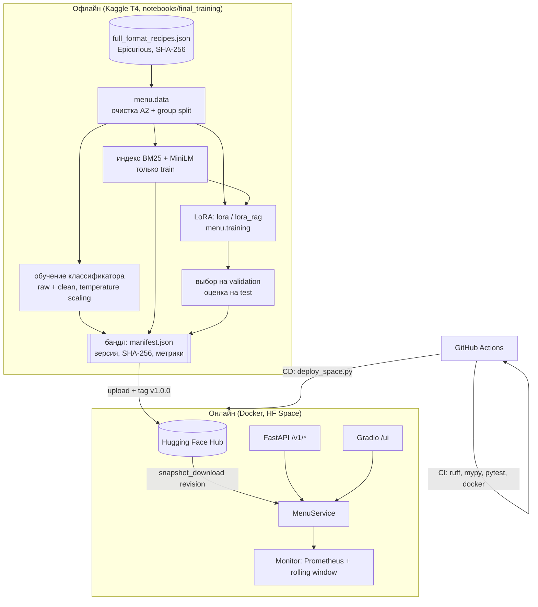
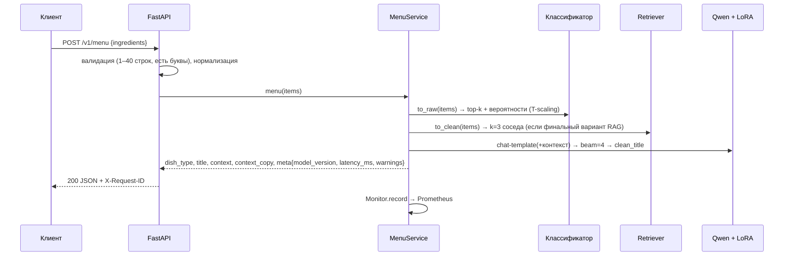

# Архитектура

## 1. Компоненты

| компонент | модуль | ответственность |
|---|---|---|
| Нормализация ввода | `menu.text` | разбор «строка/список», `clean_ingredient`, представления `ing_raw`/`ing_clean` — **один код для обучения и сервиса** |
| Данные | `menu.data` | 9 шагов очистки A2, правила типа блюда, union-find группы, `StratifiedGroupKFold`, проверка утечки |
| Классификатор | `menu.models.classifier` | TF-IDF(1–2) + LinearSVC, temperature scaling, OOV-доля (сигнал дрейфа) |
| Retriever | `menu.rag.retriever` | BM25 по ингредиентам и названиям, опционально плотные эмбеддинги, слияние RRF, исключение групп |
| Промпты | `menu.rag.prompts` | форматы сообщений для названия (с/без контекста) и чата, разбор ответа |
| Генератор | `menu.models.generator` | Qwen2.5-0.5B, мульти-адаптер PEFT (`lora`, `lora_rag`, zero-shot), fallback без LLM |
| Сервис | `menu.service` | сценарии classify / generate / menu / search / chat, деградация, метаданные версии |
| API | `menu.api.app` | FastAPI, Pydantic-контракт, request-id, JSON-логи, ключ API, `/health`, `/metrics` |
| UI | `menu.ui.gradio_app` | вкладки: меню, сравнение моделей, чат, мониторинг, о модели |
| Мониторинг | `menu.monitoring` | Prometheus-метрики, скользящее окно, дрейф по OOV, журнал предсказаний |
| Бандл | `menu.bundle` | сборка, манифест, проверка SHA-256, загрузка pinned-ревизии с HF Hub |

## 2. Поток запроса `/v1/menu`

## 3. Ключевые решения

| решение | почему | альтернативы |
|---|---|---|
| Пакет `src/menu`, а не ноутбуки | один код для обучения, оценки и сервиса → нет training/serving skew; тестируемость | генерация ячеек (как в A3/A4) |
| Классификатор — линейная модель, а не DistilBERT | лучше на test (0.719 против 0.698 в A4), <1 мс на CPU, калибруется | DistilBERT: медленнее на CPU, хуже на малых классах |
| Обучение на двух форматах ввода | пользователи пишут «rum; lime», а не «2 oz rum»: macro-F1 на таком вводе 0.632 → 0.669 | только `ing_raw` (A4) |
| BM25 + плотные эмбеддинги + RRF | BM25 точен на списках ингредиентов, эмбеддинги — на свободных вопросах чата | только TF-IDF (A4): ROUGE@1 соседа 0.185 против 0.225 у BM25 |
| Точный поиск (матрица) вместо FAISS | 14.5 тыс. документов → 0.4 мс/запрос, без лишней зависимости | FAISS/HNSW — нужен при >10⁶ документов |
| Один Qwen + переключаемые адаптеры | 1 копия весов в памяти, адаптер 35 МБ, zero-shot = `disable_adapter()` | отдельная модель на вариант — ×3 памяти |
| LoRA-RAG обучается с исключением группы | иначе модель учится копировать название из контекста | обучение без исключения |
| Бандл + manifest + SHA-256 на HF Hub | фиксированная версия модели, проверка целостности, откат = смена ревизии | веса в git/LFS, «latest» без версии |
| Деградация вместо падения | без LLM сервис отвечает классификацией, поиском и fallback-названием (`degraded=true`) | 503 на весь сервис |
| FastAPI + Gradio в одном процессе | одна точка развёртывания на бесплатном Space, общий мониторинг | отдельные фронтенд/бэкенд |

## 4. Нефункциональные свойства

* **Воспроизводимость:** seed 42; разбиение пересобирается из сырого JSON бит-в-бит; `uv.lock`; SHA данных и
  файлов модели в манифесте; ревизия базовой модели закрепляется в манифесте.
* **Надёжность:** health/readiness (`/health` — `loading | ok | degraded`), Docker `HEALTHCHECK`, фоновая загрузка LLM
  (сервис принимает запросы сразу), блокировка генерации от конкурентного доступа.
* **Безопасность:** опциональный `X-API-Key` для `/v1/*`, ограничения длины ввода, контейнер под uid 1000, секреты
  только в GitHub/Kaggle Secrets.
* **Наблюдаемость:** JSON-логи с request-id, Prometheus-метрики, алерты, Grafana, журнал предсказаний (JSONL).
