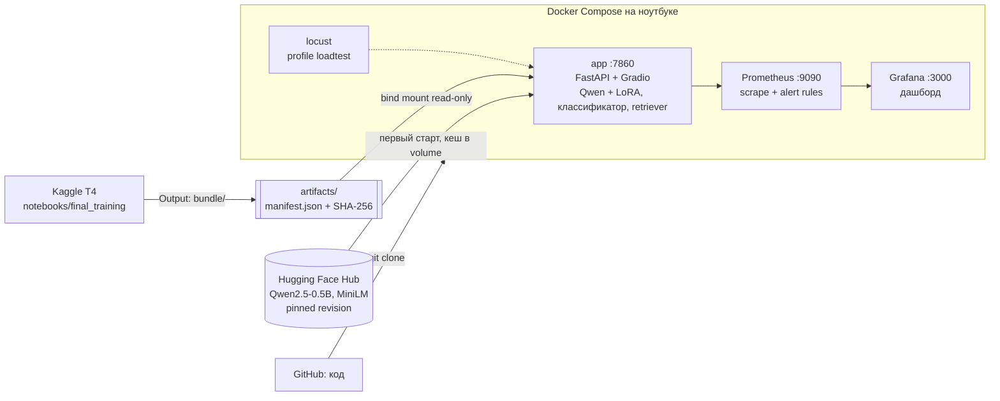

# Развёртывание



## 1. Обучение модели (один раз, ~1.5 ч на Kaggle T4)

1. Kaggle → *New Notebook* → *File → Import Notebook* → `notebooks/final_training.ipynb`.
2. *Add Input* → `hugodarwood/epirecipes`; Accelerator **GPU T4**, Internet **On**.
3. *Save Version → Save & Run All*.
4. *Output → Download*: архив содержит `bundle/` (готовый бандл модели) и `final_eval.json` (сравнение вариантов).

Без токена Hugging Face ноутбук просто сохраняет бандл в Output. С секретом `HF_TOKEN` (право write) он ещё и
публикует бандл в `<ваш-HF-логин>/menu-from-nn` с тегом `v1.0.0`.

## 2. Локальное развёртывание (основной вариант, Windows + Docker Desktop)

```text
MenuFromNN\
├── artifacts\            ← содержимое bundle\ из Output Kaggle (manifest.json, classifier.joblib, retriever.joblib, generator\)
├── start_local.bat       ← сборка и запуск: сервис + Prometheus + Grafana, ожидание готовности, открытие браузера
├── stop_local.bat        ← остановка
└── loadtest_local.bat    ← 2-минутный нагрузочный тест (locust в контейнере) → reports\perf\local_full*.csv/html
```

1. Запустить Docker Desktop (статус *Engine running*).
2. Двойной щелчок `start_local.bat`. Первый запуск: сборка образа ~5–10 мин, загрузка Qwen и MiniLM ~1–3 мин
   (кешируются в volume `hf-cache`, повторные старты ~30 с).
3. Адреса:

| сервис | адрес |
|---|---|
| UI | http://localhost:7860/ui |
| REST API (Swagger) | http://localhost:7860/docs |
| health / метрики | http://localhost:7860/health · http://localhost:7860/metrics |
| Prometheus (алерты: *Alerts*) | http://localhost:9090 |
| Grafana (дашборд *Menu from Neural Networks*) | http://localhost:3000 (admin / admin) |

Linux/macOS: `docker compose up -d --build`, нагрузочный тест: `docker compose --profile loadtest run --rm loadtest`.

Без Docker: `uv sync --extra llm && uv run menu serve` (тот же `artifacts/`).

### Что фиксирует версию

* образ собирается из `uv.lock` (точные версии всех библиотек, torch CPU);
* `artifacts/manifest.json`: `bundle_version`, SHA-256 данных и каждого файла модели, ревизия базовой Qwen;
* при старте сервис сверяет SHA-256 (`/health → bundle_integrity`), версия возвращается в каждом ответе
  (`meta.model_version`) и в метрике `menu_build_info`.

**Обновление модели** — заменить `artifacts/` новым бандлом и перезапустить; **откат** — вернуть прежний бандл.

## 3. Опционально: публичный деплой на Hugging Face Spaces

Workflow `.github/workflows/deploy.yml` разворачивает тот же Docker-образ в HF Space после зелёного CI.
Нужны секрет `HF_TOKEN` (write) и переменные `HF_SPACE`, `HF_MODEL_REPO`, `HF_MODEL_REVISION` в настройках GitHub
(*Settings → Secrets and variables → Actions*); без `HF_SPACE` деплой пропускается.

## 4. Ресурсы

| режим | RAM | диск |
|---|---|---|
| полный (Qwen 0.5B fp32 + MiniLM) | ~3 ГБ | образ ~2.5 ГБ + веса 1.1 ГБ |
| лёгкий (`docker build --build-arg WITH_LLM=0`) | ~400 МБ | ~600 МБ |
