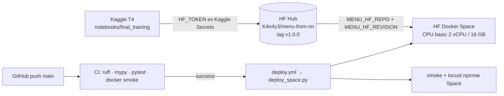

# Развёртывание



## 1. Обучить и опубликовать модель (один раз, ~1.5–2 ч на Kaggle)

1. Hugging Face → Settings → Access Tokens → создать токен с правом **write**.
2. Kaggle → *New Notebook* → *File → Import Notebook* → `notebooks/final_training.ipynb`.
3. *Add Input* → `hugodarwood/epirecipes`; *Settings*: Accelerator **GPU T4**, Internet **On**.
4. *Add-ons → Secrets* → добавить `HF_TOKEN` (вводите токен сами) и включить его для ноутбука.
5. При необходимости поменять `CONFIG["hf_repo"]` (по умолчанию `K4n4y3/menu-from-nn`).
6. *Save Version → Save & Run All*. В конце: `published https://huggingface.co/K4n4y3/menu-from-nn revision … tag v1.0.0`.

Без токена бандл остаётся в *Output → bundle/*; загрузить вручную:
`hf upload K4n4y3/menu-from-nn ./bundle . && hf repo tag create K4n4y3/menu-from-nn v1.0.0`.

## 2. Настроить автодеплой (один раз)

GitHub → репозиторий → *Settings → Secrets and variables → Actions*:

| тип | имя | значение |
|---|---|---|
| secret | `HF_TOKEN` | тот же write-токен |
| variable | `HF_SPACE` | `K4n4y3/menu-from-nn` (Space создастся сам) |
| variable | `HF_MODEL_REPO` | `K4n4y3/menu-from-nn` |
| variable | `HF_MODEL_REVISION` | `v1.0.0` |

Затем *Actions → Deploy to Hugging Face Spaces → Run workflow* (или любой push в `main`). Workflow загружает в Space
только Dockerfile, lock-файл и `src/`, задаёт переменные `MENU_HF_*`, ждёт `status: ok` и запускает нагрузочный тест —
отчёт в артефакте `load-test-report` и в summary запуска.

Адрес: `https://k4n4y3-menu-from-nn.hf.space/ui` (API: `/docs`). Первая сборка образа ~5–8 мин, старт с загрузкой
модели ~1–2 мин. Бесплатный Space засыпает после 48 ч без запросов и просыпается при первом обращении.

**Откат модели** — поменять `HF_MODEL_REVISION` на предыдущий тег и перезапустить Space; **откат кода** — revert в git.

## 3. Локально

```bash
uv sync --extra llm
MENU_HF_REPO=K4n4y3/menu-from-nn MENU_HF_REVISION=v1.0.0 uv run menu serve    # бандл скачается в ./artifacts
```

Docker с мониторингом:

```bash
MENU_HF_REPO=K4n4y3/menu-from-nn MENU_HF_REVISION=v1.0.0 docker compose up --build
# UI http://localhost:7860/ui · Prometheus http://localhost:9090 · Grafana http://localhost:3000
```

Лёгкий образ без LLM (классификация, поиск, fallback-генерация): `docker build --build-arg WITH_LLM=0 -t menu:light .`

## 4. Требования к ресурсам

| режим | RAM | диск | примечание |
|---|---|---|---|
| полный (Qwen 0.5B fp32 + MiniLM) | ~3 ГБ | ~2.5 ГБ образ + 1.1 ГБ веса | 2 vCPU достаточно |
| лёгкий (`WITH_LLM=0`) | ~400 МБ | ~600 МБ | |
